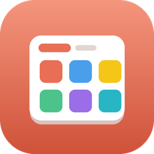
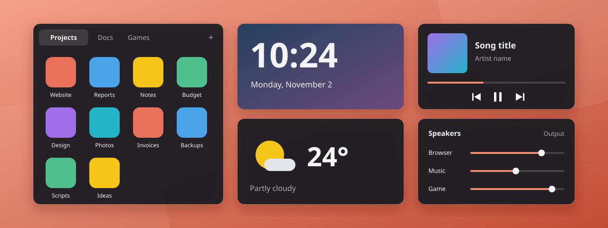

<div align="center">



# OpenWinBox

**Виджеты с открытым исходным кодом для рабочего стола Windows: папки, музыка, часы, погода и звук всегда на виду.**

[](https://github.com/yosefhdev/Open-WinBox/releases)


[English](../../README.md) · [Español](README.es.md) · [Français](README.fr.md) · [Português](README.pt-BR.md) · [Deutsch](README.de.md) · [Italiano](README.it.md) · **Русский** · [简体中文](README.zh-CN.md) · [日本語](README.ja.md) · [한국어](README.ko.md)

<br>



<sub>Иллюстрация типов виджетов. Реальный вид зависит от темы и настроек.</sub>

</div>

> [!NOTE]
> OpenWinBox находится в стадии **бета**. Между версиями что-то может меняться или не работать. Сообщайте о проблемах во вкладке [Issues](https://github.com/yosefhdev/Open-WinBox/issues).

## Что такое OpenWinBox?

Рабочий стол Windows быстро заполняется разрозненными файлами, а чтобы узнать время в другой стране или переключить песню, приходится открывать ещё одно приложение. OpenWinBox размещает на рабочем столе небольшие виджеты, и всё это всегда перед глазами.

Программа работает из области уведомлений, не требует учётной записи, а удаление виджета никогда не удаляет ваши файлы.

## Виджеты

### Виджеты папок

Превратите любую папку в виджет, показывающий её файлы и ярлыки.

- **Перетаскивание:** перетащите файлы или ярлыки на виджет, чтобы добавить их, и откройте двойным щелчком.
- **Вкладки как в браузере:** объединяйте несколько виджетов в один, меняйте порядок вкладок перетаскиванием или вытаскивайте вкладку, чтобы отделить её.
- **На ваш вкус:** переименовывайте виджеты, используйте эмодзи или изображение как значок, закрепляйте положение и расставляйте значки в любом порядке.

### Функциональные виджеты

Включайте и выключайте каждый по отдельности, а чтобы увидеть параметры, щёлкните его строку в настройках.

| Виджет | Что делает |
|---|---|
| 🎵 **Музыка** | Показывает, что играет в любом приложении, с кнопками управления и тремя стилями |
| 🟢 **Spotify** | То же самое только для Spotify, с перемешиванием и повтором |
| 🕒 **Glance** | Большие часы на фоне фото дня Bing, с дополнительным вторым часовым поясом и 12- или 24-часовым форматом |
| ☀️ **Погода** | Текущая погода для вашего местоположения или любого города |
| 🔊 **Аудио** | Переключайте вывод и микрофон и настраивайте громкость каждого приложения, как в Win+G |

## Чем это может понравиться

- **Остаётся на рабочем столе.** Виджеты находятся за окнами приложений, остаются видимыми при Win+D и никогда не появляются на панели задач и в Alt+Tab.
- **Встаёт на место.** Виджеты мягко выравниваются друг по другу и по краям экрана.
- **Светлая и тёмная темы.** Следуйте системной теме или выберите свою.
- **Не мешает в простое.** Использует около 0,05 секунды процессорного времени в минуту.
- **Импорт из DeskBox.** Если установлен DeskBox 1.5, ваши виджеты, их порядок и значки импортируются при первом запуске.

## Установка

**Нужна** Windows 10 версии 1809 или новее либо Windows 11 (64-бит). Всё остальное входит в установщик, поэтому устанавливать .NET не нужно.

1. Скачайте последний `OpenWinBox-<версия>-Setup.exe` со страницы [Releases](https://github.com/yosefhdev/Open-WinBox/releases).
2. Запустите его. Программа устанавливается только для вашего пользователя и не запрашивает права администратора.
3. Откройте OpenWinBox. При первом запуске откроется краткое руководство.

> [!IMPORTANT]
> Установщик пока не подписан, поэтому Windows может показать сообщение *Система Windows защитила ваш компьютер*. Нажмите **Подробнее**, затем **Выполнить в любом случае**. Чтобы проверить загрузку, сравните хеш с `SHA256SUMS.txt` в релизе. Если включено интеллектуальное управление приложениями, Windows может заблокировать приложение без возможности продолжить.

## Как пользоваться

> [!TIP]
> Пока интерфейс на **испанском**. Надписи, которые вы увидите на экране, выделены *курсивом*.

Запомните два элемента: **F7** показывает или скрывает все виджеты, а **значок в области уведомлений** открывает меню по правому щелчку.

<details open>
<summary><b>Повседневные действия</b></summary>
<br>

| Действие | Как |
|---|---|
| Показать или скрыть все виджеты | Нажмите **F7** или щёлкните левой кнопкой по значку в области уведомлений |
| Открыть настройки | Правый щелчок по значку в области уведомлений → *Configuración…*, или запустите приложение ещё раз |
| Новый виджет | **+** на любом виджете → *Nuevo widget*, или *Configuración → Widgets de archivos → Nuevo widget* |
| Новая вкладка в виджете | **+** → *Nueva pestaña en este widget* |
| Добавить файлы | Перетащите файлы или ярлыки на виджет (удерживайте **Ctrl**, чтобы скопировать ярлык, а не переместить) |

</details>

<details>
<summary><b>Упорядочивание виджетов</b></summary>
<br>

| Действие | Как |
|---|---|
| Переименовать, сменить значок, закрепить, сгруппировать | **⋯** на виджете → *Cambiar nombre*, *Cambiar icono…*, *Bloquear posición*, *Agrupar con…* |
| Сгруппировать два виджета | Перетащите виджет за панель и удерживайте над панелью другого, пока не появится *Suelta para unir*, затем отпустите |
| Переставить или отделить вкладки | Перетащите вкладку вбок, чтобы переставить её, или за пределы виджета, чтобы сделать её отдельной |
| Переместить функциональный виджет | Наведите на него курсор и перетащите за маркер вверху |

</details>

<details>
<summary><b>Настройки</b></summary>
<br>

| Действие | Как |
|---|---|
| Включить или выключить функциональные виджеты | *Configuración → Widgets funcionales* |
| Сменить тему | *Configuración → Apariencia → Tema* |
| Запуск вместе с Windows | *Configuración → General → Lanzar al inicio*, или *Iniciar con Windows* в меню области уведомлений |

</details>

## Обновления

Откройте *Configuración → Acerca de* и нажмите *Buscar actualizaciones*. Если есть новая версия, кнопка *Actualizar* скачает её, проверит хеш и установит, сохранив ваши настройки. Приложение ненадолго закроется и откроется снова.

В разделе *Canal de actualizaciones* выберите *Oficiales*, чтобы получать только стабильные версии, или *Betas*, чтобы получать также тестовые. Для этого OpenWinBox подключается к GitHub только при нажатии кнопки.

## Конфиденциальность

В OpenWinBox нет учётных записей и собственной аналитики. Ваши настройки остаются на вашем компьютере, в `%LOCALAPPDATA%\OpenWinBox`.

Два виджета подключаются к онлайн-сервисам напрямую с вашего компьютера, без ключа API:

| Виджет | Сервис | Для чего |
|---|---|---|
| Погода | [Open-Meteo](https://open-meteo.com/) | Прогноз и поиск городов |
| Погода | [BigDataCloud](https://www.bigdatacloud.com/) | Название города для вашего местоположения |
| Погода | [ipapi.co](https://ipapi.co/) | Приблизительное местоположение, когда определение местоположения Windows выключено |
| Glance | Microsoft Bing | Фото дня |

Виджеты «Музыка» и Spotify считывают то, что Windows сообщает о воспроизведении, поэтому вход в учётную запись не нужен. Условия каждого сервиса приведены в [THIRD-PARTY-NOTICES.md](../../THIRD-PARTY-NOTICES.md).

## Удаление

1. Выберите *Salir* в меню области уведомлений.
2. Удалите OpenWinBox в разделе **Параметры Windows → Приложения → Установленные приложения**. Запуск вместе с Windows тоже будет удалён.
3. Необязательно: удалите `%LOCALAPPDATA%\OpenWinBox`, чтобы стереть и настройки.

## Сборка из исходного кода

Нужен [.NET 8 SDK](https://dotnet.microsoft.com/download/dotnet/8.0).

```bash
git clone https://github.com/yosefhdev/Open-WinBox.git
cd Open-WinBox
dotnet build src/OpenWinBox/OpenWinBox.csproj -c Release
```

Приложение создаётся в `src/OpenWinBox/bin/Release/net8.0-windows10.0.19041.0/win-x64/OpenWinBox.exe`.

Чтобы собрать установщик, установите [Inno Setup 6](https://jrsoftware.org/isinfo.php) и запустите `tools/publish.ps1`. Результат появится в `dist/`.

Создано на C#, [WinUI 3](https://github.com/microsoft/microsoft-ui-xaml) и [Windows App SDK](https://github.com/microsoft/WindowsAppSDK).

## Версии

OpenWinBox использует [семантическое версионирование](https://semver.org/lang/ru/). Беты нумеруются `1.0.0-beta.N` до финальной `1.0.0`. См. [CHANGELOG.md](../../CHANGELOG.md).

## Участие

Сообщения об ошибках, идеи и pull request'ы приветствуются. Для крупных изменений сначала откройте issue. С чего начать работу с кодом, описано в [руководстве для разработчиков](../development.md) (на английском).

## Лицензия

[MIT](../../LICENSE) © 2026 Yosefh. Сторонние компоненты и сервисы перечислены в [THIRD-PARTY-NOTICES.md](../../THIRD-PARTY-NOTICES.md). Данные о погоде: [Open-Meteo.com](https://open-meteo.com/) (CC BY 4.0).

OpenWinBox — независимый проект, не связанный с Microsoft, Spotify или DeskBox.
